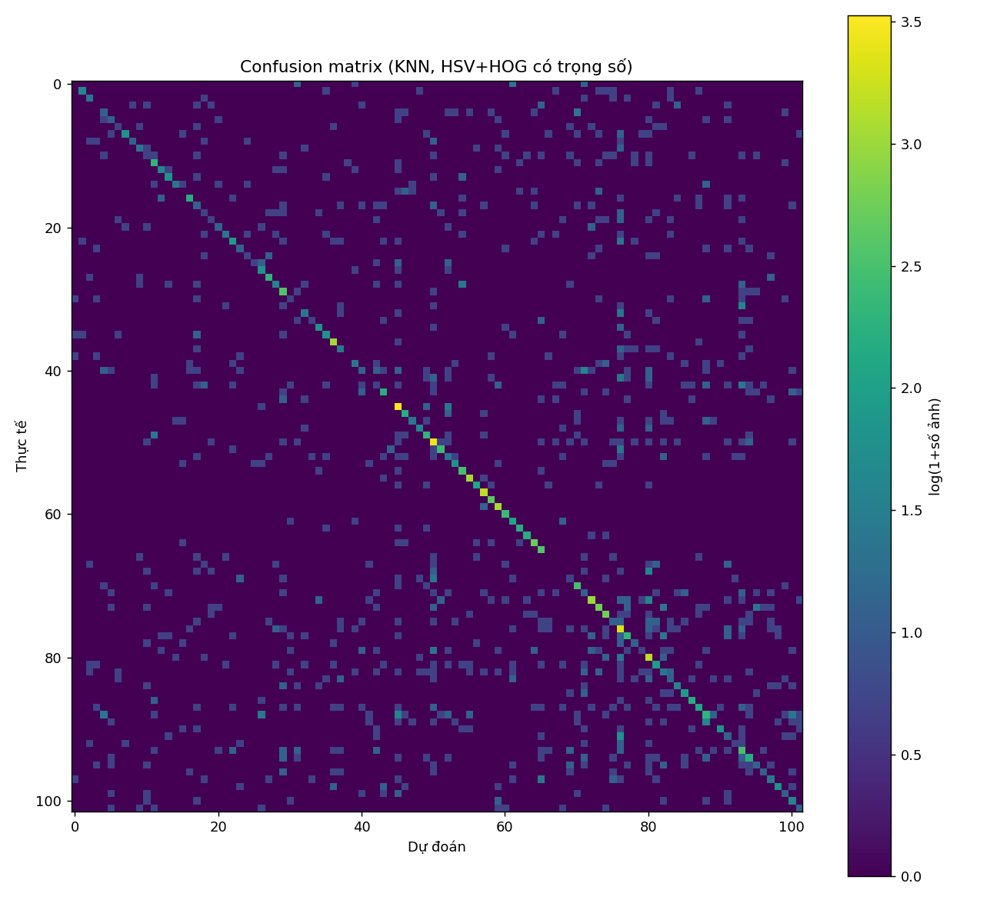

# FIT4013 - Nhóm 8 - Đề tài: Phân loại ảnh hoa

Bài tập lớn học phần Nhập môn Học máy (FIT4013), năm học 2026-2027. Nhóm 2 người.

## Thành viên nhóm

| STT | Họ và tên | Lớp | Mã sinh viên |
|:---:|:---|:---:|:---:|
| 1 | Nguyễn Qaung Vịnh | CNTT 18-02 | 1871020662 |
| 2 | Nguyễn Xuân Hải| CNTT 18-02 | 1871020207 |

`random_state = 42`.

Bài toán: phân loại ảnh 102 loài hoa (102 lớp) bằng K-NN, Cây quyết định và Naive Bayes, so sánh các cách biểu diễn đặc trưng (pixel, HSV, HOG, HSV+HOG) trên ảnh gốc và ảnh tách nền.

## Dữ liệu

Bộ dữ liệu Oxford 102 Flowers (M.-E. Nilsback, A. Zisserman, ICVGIP 2008): 8.189 ảnh, 102 lớp, mỗi lớp 40 đến 258 ảnh (lệch lớp khoảng 6,45 lần). Không có ảnh lỗi; có 4 nhóm ảnh trùng nhưng cùng nằm trong một tập (train hoặc test).

Tải tại https://www.robots.ox.ac.uk/~vgg/data/flowers/102/ gồm 4 file: `102flowers.tgz`, `102segmentations.tgz`, `imagelabels.mat`, `setid.mat`. Dữ liệu không được đưa lên repo vì dung lượng lớn.

## Cấu trúc thư mục

```
notebooks/   notebook Colab chạy toàn bộ thí nghiệm
results/     kết quả CSV/JSON, hình EDA, confusion matrix
model/       flower_model_final.joblib (mô hình cuối)
app/         GUI demo (đang cập nhật)
```

## Cách chạy

1. Mở `notebooks/flower_classification.ipynb` bằng Google Colab.
2. Upload 4 file dữ liệu vào `/content`, mount Google Drive (kết quả được lưu vào `MyDrive/flowers_results`).
3. Chọn Runtime → Run all.

## Thiết lập thí nghiệm

- Ảnh resize 64x64. Chia train/test 80/20, có stratify theo nhãn, `random_state=42` (6.551 train, 1.638 test).
- Đặc trưng: pixel, histogram HSV (8x4x4), HOG (9 hướng, ô 8x8, khối 2x2), HSV+HOG.
- Chọn tham số bằng GridSearchCV với StratifiedKFold(5, shuffle=True, random_state=42), thang đo F1-macro. Tập test chỉ dùng để báo cáo.
- Pipeline: StandardScaler, PCA, bộ phân loại (chỉ fit trên tập train).
- Môi trường: Python 3.13, scikit-learn 1.6.1, scikit-image 0.25.2.

## Kết quả chính (tập test, mô hình đã tinh chỉnh)

| Mô hình | Đặc trưng | Accuracy | F1-macro |
|:---|:---|:---:|:---:|
| Baseline (K-NN mặc định) | pixel xám | 0,074 | 0,051 |
| K-NN | HSV | 0,361 | 0,313 |
| Naive Bayes | HSV+HOG | 0,263 | 0,243 |
| Decision Tree | HSV | 0,216 | 0,184 |
| **K-NN, HSV nhân trọng số 3,7 (mô hình cuối)** | HSV+HOG | **0,385** | **0,334** |

Mô hình cuối: K-NN (k=5, weights=distance), PCA 50 thành phần, CV F1-macro 0,319. Trên phép chia chính thức của tác giả (2.040 train, 6.149 test), K-NN với HSV đạt accuracy 0,250 và F1-macro 0,222. Số liệu đầy đủ trong `results/test_results_with_baseline.csv`.



## Nhận xét

- Màu sắc (HSV) là đặc trưng hiệu quả nhất; HOG không giúp nếu không cân trọng số.
- Ảnh tách nền không cải thiện đồng đều: tăng với Decision Tree, giảm với K-NN và Naive Bayes.
- Có 11 lớp có F1 bằng 0 ở mô hình cuối, các lớp hoa có màu tương tự nhau dễ bị nhầm.
- Lưu ý: ý tưởng trọng số HSV được rút ra sau khi phân tích lỗi trên tập test, dù việc chọn tham số vẫn dựa trên CV của tập train.
